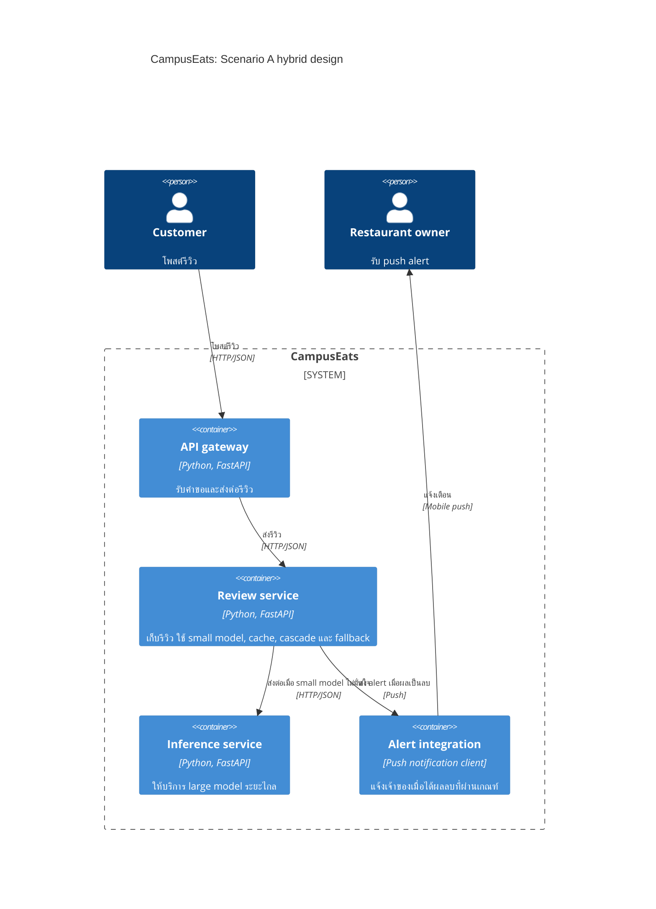

# Tutorial 6: คำตอบ Tasks 1–3 และ Task 4

**Name / ชื่อ:** ชวาทิก เจนกิจเจริญชัย  
**Student ID / รหัสนิสิต:** 6772017421

## Task 0: Baseline

| Run | p50 ms | p95 ms | accuracy | large calls |
|---|---:|---:|---:|---:|
| `t0-large` | 510 | 620 | 93.5% | 100% |
| `t0-small` | 120 | 279 | 72.5% | 0% |

**Q0.** large model เพิ่ม accuracy จาก 72.5% เป็น 93.5% แต่แลกกับ latency ที่สูงขึ้นและการเรียกโมเดลที่มีค่าใช้จ่ายทุกรีวิว

## Task 1: Fallback prediction

| Run | run time (s) | p50 ms | p95 ms | errors | pending | accuracy |
|---|---:|---:|---:|---:|---:|---:|
| `t1-before` | ไม่มีผลวัดใน `results/runs.csv` | — | — | — | — | — |
| `t1-after` | 10.1 | 415 | 1041 | 0 | 22 | 94.4%* |

\*Accuracy คำนวณเฉพาะรีวิวที่ได้ label; run นี้มี 22 รีวิวเป็น pending จากทั้งหมด 200 รีวิว

**Q1.1** p50 แสดงเพียงค่ากึ่งกลาง จึงอาจไม่สะท้อนรีวิวส่วนน้อยที่ค้างนานหรือหมดเวลาได้ ควรดู p95, `errors` และ `pending` ประกอบด้วย; ไม่มีผล `t1-before` ใน CSV ปัจจุบัน จึงเปรียบเทียบตัวเลขก่อน/หลังโดยตรงไม่ได้

**Q1.2** คำขอที่รอโมเดลยังใช้การเชื่อมต่อและทรัพยากร/ช่องทางทำงานของ review service และ gateway อยู่ คำขอที่ค้างหลายรายการจึงอาจทำให้คำขอใหม่ต้องรอเป็นแถวและเพิ่มความล่าช้าทั้งระบบ

**Q1.3** ควรเก็บรีวิว pending อย่างถาวร แล้วให้ worker หรืองาน batch ลองจัด label ใหม่ภายหลัง ซึ่งสอดคล้องกับ topology แบบ asynchronous/batch (T4)

**Q1.4** Timeout 0.1 วินาทีสั้นเกินไป อาจทำให้คำขอที่ช้าเพียงชั่วคราวกลายเป็น pending จำนวนมาก ส่วน 10 วินาทีนานเกินข้อกำหนด 1 วินาที ทำให้ผู้ใช้และทรัพยากรของบริการต้องรอนาน

## Task 2: Cascade

| Run | threshold | p50 ms | p95 ms | accuracy | large calls |
|---|---:|---:|---:|---:|---:|
| `t2-0.6` | 0.6 | 41 | 529 | 91.5% | 38% |
| `t2-0.7` | 0.7 | 385 | 623 | 93.0% | 53% |
| `t2-0.8` | 0.8 | 456 | 604 | 93.5% | 64% |
| `t2-0.9` | 0.9 | 529 | 678 | 93.5% | 77% |

**Q2.1** สำหรับข้อกำหนดทั่วไปที่ต้องการ accuracy อย่างน้อย 90% เลือก threshold 0.6: ได้ accuracy 91.5% และเรียก large model 38% ซึ่งต่ำสุดในชุดที่วัด ยอมเสีย accuracy 2 จุดเปอร์เซ็นต์เมื่อเทียบกับ `t0-large` เพื่อประหยัดค่าใช้จ่าย

**Q2.2** ที่ threshold 0.6 p50 อยู่ที่ 41 ms เพราะคำขอจำนวนมากตอบได้จาก small model โดยไม่ต้องรอ large model แต่ p95 ยังเป็น 529 ms เพราะคำขอส่วนน้อยที่ถูกส่งต่อไป large model เป็นตัวกำหนดช่วงหางของ latency

**Q2.3** Small model อาจมั่นใจผิดกับข้อความที่มีคำปฏิเสธหรือความหมายประชด เช่น “not bad” แล้วให้ label ผิด ผู้ใช้อาจเห็นรีวิวเชิงบวกถูกมองเป็นลบหรือกลับกัน

## Task 3: Cached predictions

| Run | p50 ms | p95 ms | accuracy | large calls | cache hits |
|---|---:|---:|---:|---:|---:|
| `t3-cache` | 38 | 577 | 93.5% | 40% | 34% |

**Q3.1** รีวิวข้อความเดิมที่ต่างกันแค่ตัวพิมพ์เล็ก/ใหญ่หรือช่องว่างใช้ cache ได้ ส่วนข้อความที่ไม่ซ้ำจะ miss ในครั้งแรก และข้อความที่ไม่กลับมาอีกก็ไม่ได้ประโยชน์จาก cache

**Q3.2** เมื่อเปลี่ยน large model ต้องล้าง cache เก่าหรือแยก key ตาม model version เพื่อไม่ให้คืน prediction จากโมเดลรุ่นก่อน อาจกำหนด TTL เพิ่มเติมเพื่อจำกัดอายุของข้อมูลใน cache

## Debrief

**Q4.** จาก `t2-0.8` เทียบกับ `t3-cache` พบว่า cache ลด p50 จาก 456 ms เหลือ 38 ms และ large calls จาก 64% เหลือ 40% แต่ p95 ลดเพียงเล็กน้อยจาก 604 ms เป็น 577 ms เพราะคำขอที่ cache ไม่ได้ยังต้องรอ large model

# Task 4: Deployment topologies and trade-offs

**Scenario (A, B or C) / Scenario ที่เลือก:** A — Owner alerts

## 1. Quality requirements

| # | Quality | Requirement |
|---|---|---|
| 1 | Latency | ส่ง alert สำหรับรีวิวเชิงลบภายใน 2 วินาที |
| 2 | Accuracy | ลด alert ที่ผิดให้น้อยที่สุด; ใช้ QR3 ของระบบเป็นเกณฑ์อ้างอิง คือ accuracy อย่างน้อย 90% |
| 3 | Capacity | large model ต้องรองรับการใช้งานที่ peak โดยไม่เกิน 20 calls/s |

## 2. Design / การออกแบบ

เลือก **T3: Hybrid** ใช้ small model ภายใน review service และเรียก large model ระยะไกลผ่าน cascade เฉพาะเมื่อ small model ไม่มั่นใจ เพิ่ม cache สำหรับข้อความซ้ำ และ fallback ให้บันทึกรีวิวเป็น `pending` เมื่อ inference ใช้เวลานานหรือเกิด error

## 3. Evidence / หลักฐาน

ผลจาก `results/runs.csv`:

| Run | ผลที่วัดได้ | ความหมาย |
|---|---|---|
| `t0-large` | accuracy 93.5%, p95 620 ms, large calls 100% | ความแม่นยำสูง แต่ทุกรีวิวเรียก large model |
| `t0-small` | accuracy 72.5%, p95 279 ms, large calls 0% | เร็วและไม่เรียก large model แต่ accuracy ต่ำกว่าเกณฑ์ 90% |
| `t2-0.8` | accuracy 93.5%, p95 604 ms, large calls 64% | cascade รักษา accuracy ใกล้ large model แต่ยังเรียก large model บ่อย |
| `t3-cache` | accuracy 93.5%, p95 577 ms, large calls 40%, cache hits 34% | cache ลดจำนวน large calls และ latency ของคำขอส่วนใหญ่ |

ประมาณการ capacity โดยใช้อัตรา large calls จาก `t3-cache`:

`40 reviews/s × 40% = 16 large calls/s`

16 calls/s ต่ำกว่าขีดจำกัด 20 calls/s ส่วน p95 ที่วัดได้คือ 577 ms ซึ่งต่ำกว่า deadline 2 วินาที อย่างไรก็ตาม load test นี้ใช้ 200 รีวิวและ concurrency 10 ไม่ได้ทดสอบ peak 40 reviews/s หรือวัดเวลาส่ง push notification จริง ดังนั้นการคำนวณ capacity และ latency ที่ peak ยังต้องยืนยันด้วยการทดสอบโหลดเพิ่มเติม อัตรา cache hit และสัดส่วนคำขอที่ส่งต่ออาจเปลี่ยนตาม workload จริง

ค่า accuracy ในตารางเป็น accuracy รวม ไม่ใช่การวัด false-positive rate ของ alert โดยตรง จึงควรตรวจ precision/false-positive rate สำหรับรีวิวเชิงลบแยกก่อนใช้งานจริง

## 4. ADR

**Title:** ใช้ hybrid inference สำหรับ owner alerts  
**Status:** Proposed

**Context:** ช่วง peak มีรีวิว 40 รายการต่อวินาที และต้องแจ้งเตือนภายใน 2 วินาที Large model แม่นยำแต่มีขีดจำกัด 20 calls/s และมีค่าใช้จ่ายต่อ call ส่วน small model เร็วกว่าแต่แม่นยำน้อยกว่า

**Decision:** ใช้ T3 Hybrid โดยรัน small model ใน review service และเรียก large model ระยะไกลผ่าน cascade เมื่อ small model ไม่มั่นใจ ใช้ cache กับข้อความซ้ำ และ fallback เพื่อบันทึกรีวิวเป็น pending เมื่อ inference ล้มเหลวหรือเกิน timeout

**Consequences:**
- **Positive:** ลดการเรียก large model; ผล `t3-cache` ให้ accuracy 93.5% และประมาณการใช้งาน large model 16 calls/s ที่ peak
- **Negative:** มีองค์ประกอบและการดูแล cache เพิ่มขึ้น; งานวัดปัจจุบันยังไม่ยืนยัน throughput ที่ peak หรือความแม่นยำของ negative alert โดยเฉพาะ

**Alternatives considered:**
- **T1: large model ทุกรีวิว** — ปฏิเสธ เพราะ 40 รีวิว/s สูงกว่าขีดจำกัด 20 calls/s
- **T2: small model อย่างเดียว** — ปฏิเสธ เพราะผล `t0-small` มี accuracy 72.5% ต่ำกว่าเกณฑ์ 90%
- **T4: asynchronous/batch** — ปฏิเสธเป็นเส้นทางหลัก เพราะการประมวลผลล่าช้าไม่เหมาะกับ alert ภายใน 2 วินาที
